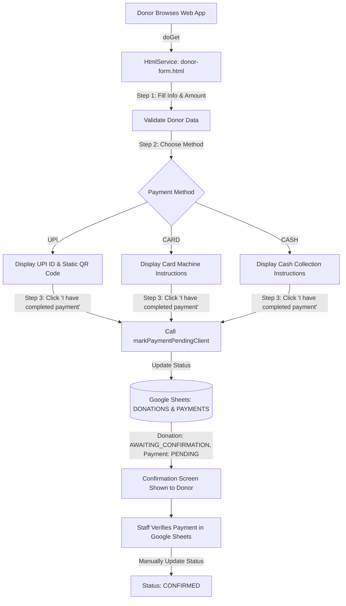

# Serverless Donor Web App & Receipt Automation System

A lightweight, cost-effective, serverless donation collection and receipt automation web application built for non-profit organizations (NGOs). The system uses **Google Apps Script** as the backend engine and **Google Sheets** as the database layer, eliminating monthly hosting, server management, and database infrastructure costs.

---

## Table of Contents

- [Overview](#overview)
- [Key Features](#key-features)
- [Technology Stack](#technology-stack)
- [System Architecture & Workflow](#system-architecture--workflow)
- [Repository Structure](#repository-structure)
- [Current Implementation Status](#current-implementation-status)
- [Google Sheets Data Model](#google-sheets-data-model)
- [Payment & Confirmation Workflow](#payment--confirmation-workflow)
- [Configuration Approach](#configuration-approach)
- [Prerequisites & Setup Requirements](#prerequisites--setup-requirements)
- [Local Development & Clasp Workflow](#local-development--clasp-workflow)
- [Deployment Instructions](#deployment-instructions)
- [Testing Instructions](#testing-instructions)
- [Security Considerations](#security-considerations)
- [Known Limitations & Pending Features](#known-limitations--pending-features)
- [Troubleshooting](#troubleshooting)
- [License](#license)

---

## Overview

Non-profit organizations often face financial overhead and technical complexity when deploying donor-facing web applications. This project provides an enterprise-ready, serverless web solution running entirely inside Google Workspace.

Donors can access a mobile-responsive web form to enter their details and make donations via **UPI (Static QR)**, **CARD (POS machine)**, or **CASH**. Staff members track and confirm incoming payments directly within Google Sheets, which records all transactions, donor profiles, and audit trails.

---

## Key Features

- **Zero-Infrastructure Serverless Hosting**: Deployed directly as a Google Apps Script Web App.
- **Dynamic & Configurable Donor Form**: Form fields (Name, Phone, Email, PAN, Address, etc.) are rendered dynamically based on database configuration without requiring code changes.
- **Multi-Method Offline Payment Options**:
  - **UPI**: Displays organization UPI ID and static QR code image.
  - **CARD**: Provides staff POS machine payment instructions.
  - **CASH**: In-person cash collection workflow.
- **Multi-Stage Donation Lifecycle**: Tracks donations through explicit state changes (`PENDING` → `AWAITING_CONFIRMATION` → `CONFIRMED` / `FAILED` / `CANCELLED`).
- **Normalized Data Store**: Structured 6-sheet Google Sheets relational database model with automatic table and index initialization.
- **Audit Logging & Activity Tracking**: Logs system actions, field updates, and status changes with timestamps and user attribution.

---

## Technology Stack

| Layer | Technology | Purpose |
| :--- | :--- | :--- |
| **Frontend** | HTML5, Vanilla CSS, JS (ES6) | Responsive 3-step donor form UI rendered inside Apps Script `HtmlService` |
| **Backend Runtime** | Google Apps Script (V8 Engine) | Serverless execution, routing (`doGet`, `doPost`), and business logic |
| **Database** | Google Sheets | Normalized relational data store |
| **File Storage** | Google Drive | PDF receipt document storage (*Phase 6 target*) |
| **CLI / Tooling** | Google `@google/clasp` | Local development, syntax validation, and Apps Script push/pull deployment |

---

## System Architecture & Workflow



---

## Repository Structure

```
serverless-donor-webapp/
├── .clasp.json             # Google Clasp project configuration
├── .gitignore              # Git ignore rules
├── ARCHITECTURE.md         # Detailed system design specification
├── README.md               # Developer documentation (this file)
├── progress.md             # Project phase tracker
├── docs/
│   ├── admin_guide.md      # Non-technical step-by-step organization guide
│   ├── APPS_SCRIPT_SETUP.md # Technical Apps Script setup guide
│   └── GOOGLE_SHEETS_SETUP.md # Technical Google Sheets schema setup guide
├── src/
│   ├── Code.gs             # Web App entry point (doGet, doPost, route handlers, client API wrappers)
│   ├── appsscript.json     # Apps Script manifest file
│   ├── config.gs           # Configuration reader/writer DAL
│   ├── constants.gs        # System constants, enums, regex patterns, defaults
│   ├── donation.gs         # Donation entity logic & queries
│   ├── donor.gs            # Donor entity logic, lookup, and creation
│   ├── drive.gs            # Google Drive folder and file utilities
│   ├── form-fields.gs      # Form field configuration and validation engine
│   ├── logger.gs           # Audit logging module
│   ├── payment.gs          # Payment entity logic & status transition handling
│   ├── sheets.gs           # Low-level Google Sheets DAL (ensureSheet, appendRow, updateRow, findRow)
│   ├── audit.gs            # Placeholder (0 bytes)
│   ├── auth.gs             # Placeholder (0 bytes)
│   ├── dashboard.gs        # Placeholder (0 bytes)
│   ├── receipt.gs          # Placeholder (0 bytes)
│   ├── test-clasp.gs       # Placeholder (0 bytes)
│   └── html/
│       ├── donor-form.html # Main donor interface template
│       ├── styles.html     # Inline CSS stylesheet wrapper
│       ├── scripts.html    # Client-side JS controller and event handlers
│       └── admin-dashboard.html # Admin dashboard UI template placeholder (0 bytes)
└── tests/
    └── test-database.gs    # Automated Google Apps Script database test suite
```

---

## Current Implementation Status

| Phase | Description | Status | Implemented Modules |
| :---: | :--- | :---: | :--- |
| **Phase 1** | Project Setup & Architecture | ✅ Completed | Repository structure, `constants.gs`, `config.gs`, `appsscript.json` |
| **Phase 2** | Database Layer & Data Model | ✅ Completed | `sheets.gs`, `donor.gs`, `donation.gs`, `payment.gs`, `logger.gs` |
| **Phase 3** | Donor Web Interface | ✅ Completed | `html/donor-form.html`, `html/styles.html`, `html/scripts.html`, `Code.gs` handlers |
| **Phase 4** | Donation Creation Workflow | ✅ Completed | Form validation, donor creation/lookup, payment pending transition |
| **Phase 5** | Payment Confirmation Logic | 🟡 Partial | Backend status updating logic ready; Admin Dashboard UI pending |
| **Phase 6** | Automated Receipt Generation | ❌ Pending | `receipt.gs` is currently empty (not yet implemented) |
| **Phase 7** | Admin Dashboard UI | ❌ Pending | `admin-dashboard.html` & `dashboard.gs` are currently empty |
| **Phase 8** | Receipt Print/Download/Email | ❌ Pending | Automated receipt delivery pending Phase 6 completion |
| **Phase 10**| Authentication & Security UI | 🟡 Partial | Audit logging core functional; UI session auth pending (`auth.gs` empty) |

---

## Google Sheets Data Model

The application uses a relational data model spanning **6 sheets** in a single Google Spreadsheet:

### 1. `DONATIONS`
Stores overall donation records.

| Column | Type | Description |
| :--- | :--- | :--- |
| `donation_id` | String (PK) | Unique ID (e.g., `ROH20260928001`) |
| `donor_id` | String (FK) | Reference to `DONORS` table |
| `amount` | Number | Donation amount |
| `currency` | String | Currency code (`INR`) |
| `payment_method` | String | Method (`UPI`, `CARD`, `CASH`) |
| `payment_status` | String | Status (`PENDING`, `AWAITING_CONFIRMATION`, `CONFIRMED`, `FAILED`, `CANCELLED`) |
| `receipt_number` | String | Receipt number (e.g., `ROH-2026-000001`) |
| `receipt_pdf_url` | String | Google Drive URL of generated PDF receipt |
| `created_at` | ISO String | Record creation timestamp |
| `updated_at` | ISO String | Last update timestamp |
| `created_by` | String | User/system attribution |
| `notes` | String | Internal notes |

### 2. `DONORS`
Stores donor profiles and contact details.

| Column | Type | Description |
| :--- | :--- | :--- |
| `donor_id` | String (PK) | Unique ID (e.g., `D20260928001`) |
| `name` | String | Donor full name |
| `mobile` | String | 10-digit mobile number |
| `email` | String | Email address |
| `address` | String | Street address |
| `city` | String | City |
| `state` | String | State |
| `pin` | String | 6-digit PIN code |
| `country` | String | Country (`India`) |
| `pan` | String | 10-character PAN number |
| `dob` | Date String | Date of birth |
| `occupation` | String | Occupation |
| `company` | String | Company name |
| `created_at` | ISO String | Creation timestamp |
| `updated_at` | ISO String | Last update timestamp |

### 3. `PAYMENTS`
Stores individual payment transaction attempts.

| Column | Type | Description |
| :--- | :--- | :--- |
| `payment_id` | String (PK) | Unique payment ID (e.g., `P20260928001`) |
| `donation_id` | String (FK) | Reference to `DONATIONS` table |
| `amount` | Number | Payment amount |
| `currency` | String | Currency code (`INR`) |
| `payment_method` | String | Method (`UPI`, `CARD`, `CASH`) |
| `payment_status` | String | Status (`PENDING`, `CONFIRMED`, `FAILED`, `CANCELLED`) |
| `transaction_id` | String | Manual/gateway transaction reference |
| `provider` | String | Provider (`MANUAL`) |
| `provider_payment_id` | String | Provider reference ID |
| `provider_order_id` | String | Provider order ID |
| `provider_metadata` | JSON String | Additional provider payload |
| `confirmed_by` | String | User ID/email who confirmed payment |
| `confirmed_at` | ISO String | Timestamp of confirmation |
| `payment_timestamp` | ISO String | Timestamp of transaction |
| `created_at` | ISO String | Creation timestamp |
| `updated_at` | ISO String | Last update timestamp |

### 4. `FORM_FIELDS`
Defines dynamic form inputs rendered on the donor interface.

| Column | Type | Description |
| :--- | :--- | :--- |
| `field_id` | String (PK) | Unique field ID (e.g., `F001`) |
| `field_key` | String | Key identifier (e.g., `donor_name`, `mobile`, `email`, `pan`) |
| `label` | String | Display text shown on form |
| `type` | String | Field type (`text`, `number`, `date`, `phone`, `email`, `textarea`, `dropdown`) |
| `required` | String | `TRUE` or `FALSE` |
| `enabled` | String | `TRUE` or `FALSE` |
| `display_order` | Number | Integer position order |
| `placeholder` | String | Input placeholder text |
| `options` | String | Comma-separated options (for dropdown) |
| `created_at` | ISO String | Creation timestamp |
| `updated_at` | ISO String | Last update timestamp |

### 5. `CONFIGURATION`
Stores key-value system settings.

| Column | Type | Description |
| :--- | :--- | :--- |
| `key` | String (PK) | Config key (e.g., `org_name`, `org_upi_id`, `org_upi_qr_image_url`) |
| `value` | String | Config value |
| `description` | String | Explanation of setting |
| `updated_at` | ISO String | Last update timestamp |
| `updated_by` | String | Email/user who updated key |

### 6. `AUDIT_LOG`
Logs system activity and administrative changes.

| Column | Type | Description |
| :--- | :--- | :--- |
| `log_id` | String (PK) | Unique log ID |
| `timestamp` | ISO String | Event timestamp |
| `user` | String | User who performed action |
| `action` | String | Action code (`CREATED`, `UPDATED`, `CONFIRMED_PAYMENT`, etc.) |
| `entity_type` | String | Entity (`donation`, `donor`, `payment`, `configuration`) |
| `entity_id` | String | ID of affected entity |
| `old_value` | String | Previous state snippet |
| `new_value` | String | New state snippet |
| `notes` | String | Optional notes |

---

## Payment & Confirmation Workflow

1. **Submission**: Donor fills in required fields and selects a donation amount and payment method (`UPI`, `CARD`, or `CASH`).
2. **Entity Creation**:
   - System searches existing donors by mobile/email; updates profile or creates a new `DONORS` record.
   - System appends a `DONATIONS` record with status `PENDING`.
   - System appends a `PAYMENTS` record with status `PENDING`.
3. **Pending Confirmation**: Donor completes offline payment and clicks **"I have completed payment"**.
   - System updates `DONATIONS` status to `AWAITING_CONFIRMATION`.
   - Donor sees a final screen displaying their unique **Donation ID**.
4. **Staff Manual Verification**: Staff verifies bank account/cash collection and manually sets `payment_status` in the `DONATIONS` and `PAYMENTS` sheets to `CONFIRMED`.

---

## Configuration Approach

All key operational variables are non-hardcoded and dynamically read from the `CONFIGURATION` sheet via `config.gs`:

- `org_name`: Organization legal name displayed in header/footer.
- `org_upi_id`: UPI VPA ID (e.g., `ngo@upi`).
- `org_upi_qr_image_url`: Public HTTPS URL of static UPI QR code image.
- `currency`: Default currency (`INR`).
- `donation_id_prefix`: Prefix for donation IDs (default: `ROH`).

---

## Prerequisites & Setup Requirements

1. **Google Account**: Dedicated Google Account for the NGO organization.
2. **Google Spreadsheet**: A Google Sheet created inside Google Drive.
3. **Google Apps Script Project**: Apps Script bound to or associated with the Google Sheet.
4. **Clasp (Optional for developers)**: Node.js (v18+) and `@google/clasp` installed globally (`npm install -g @google/clasp`).

---

## Local Development & Clasp Workflow

The repository is configured to sync with Google Apps Script via Clasp:

```bash
# 1. Clone repository
git clone https://github.com/your-org/serverless-donor-webapp.git
cd serverless-donor-webapp

# 2. Login to Google via Clasp
clasp login

# 3. Create or clone existing Apps Script project
# (Ensure scriptId in .clasp.json matches your Google Apps Script ID)

# 4. Push local changes to Apps Script
clasp push

# 5. Open Apps Script project in browser
clasp open
```

> **Note on File Extensions**: Apps Script only supports `.gs` (server code) and `.html` (HTML outputs). Client CSS/JS files inside `src/html/` are maintained as `styles.html` and `scripts.html` to ensure `clasp push` works cleanly without build errors.

---

## Deployment Instructions

1. Open the target Google Sheet.
2. Go to **Extensions > Apps Script**.
3. Copy code files from `src/` into the Apps Script editor (or use `clasp push`).
4. Run `initialize()` once inside `Code.gs` via the Apps Script editor to auto-create all 6 sheets with headers and populate default configurations.
5. Click **Deploy > New deployment**.
6. Select type: **Web app**.
7. Set configuration:
   - **Execute as**: `Me (your google account)`
   - **Who has access**: `Anyone` (or `Anyone with Google account` based on organization preference)
8. Click **Deploy**, authorize requested permissions, and copy the published Web App URL.

---

## Testing Instructions

Automated backend unit/integration tests are located in `tests/test-database.gs`:

1. Open Apps Script Editor.
2. Select function `runAllDatabaseTests` from the top execution dropdown.
3. Click **Run** and monitor **Execution Log**.
4. Verify all 8 test modules complete successfully:
   - Initialization Test
   - Configuration System Test
   - Donor CRUD Test
   - Donation Creation Test
   - Payment Status Transition Test
   - Form Fields Logic Test
   - Audit Logging Test
   - Integration Test

---

## Security Considerations

- **Frame Security**: `handleDonorFormPage` applies `HtmlService.XFrameOptionsMode.ALLOWALL` to permit iframe embedding on NGO websites. Adjust frame permissions if embedding is restricted.
- **Input Validation**: `form-fields.gs` enforces strict regex rules for Indian mobile numbers (`/^[6-9]\d{9}$/`), email formats, 6-digit postal PIN codes (`/^\d{6}$/`), and 10-character PAN syntax.
- **No Private Keys Stored**: Standard V1 implementation requires no third-party API secret keys or payment gateway tokens.

---

## Known Limitations & Pending Features

- **Automated Receipt Generation**: PDF generation via Google Docs templates is **Not currently implemented** (`receipt.gs` is currently empty).
- **Admin Dashboard UI**: Web-based payment verification UI is **Not currently implemented** (`admin-dashboard.html` & `dashboard.gs` are empty). Staff verify payments directly in Google Sheets.
- **Email Delivery**: Automated email notification dispatch is **Not currently implemented**.
- **Admin Authentication UI**: Session-based login UI is **Not currently implemented** (`auth.gs` is empty).

---

## Troubleshooting

### Error: `TypeError: Cannot read properties of undefined (reading 'ALLOWALL')`
- **Cause**: Using `HtmlService.XFrameOptions.ALLOWALL` instead of `HtmlService.XFrameOptionsMode.ALLOWALL`.
- **Fix**: Verify `Code.gs` calls `setXFrameOptionsMode(HtmlService.XFrameOptionsMode.ALLOWALL)`.

### Error: `No HTML file named html/styles was found`
- **Cause**: Attempting to include `styles.css` when Apps Script requires `.html` files.
- **Fix**: Ensure stylesheet is in `src/html/styles.html` and included via `<?!= include('html/styles'); ?>`.

---

## License

No license has been specified for this project.
